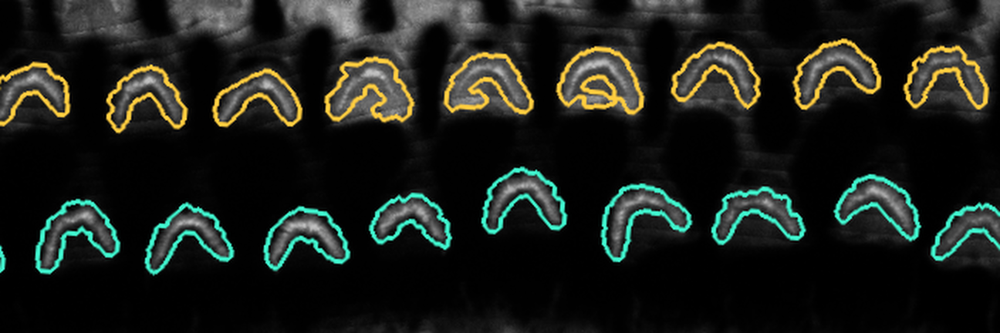

# Harp



Automatic measurement of hair cells in confocal images of mouse cochlear whole mounts, as a napari plugin: stereocilia
bundle shape and texture, inner hair cell bundles in 3D, the order and straightness of the outer hair cell rows,
nucleus size and chromatin, and hair cell identity from Calb2, Ocm or PMCA2. Group comparisons are reported with and
without adjustment for imaging depth and tissue slope, in a Word report with CSV tables.

## Install (Windows)

Download this repository (Code > Download ZIP), unzip it, type `powershell` in the File Explorer address bar of the
unzipped folder and run:

```
powershell -ExecutionPolicy Bypass -File .\install_cochlea_phenotyping.ps1
```

Then open napari from the **Harp** shortcut on the Desktop. See
`napari-cochlea-phenotyping/Harp_user_guide.docx` for a step-by-step guide.

## Contents

- `napari-cochlea-phenotyping/`: the napari plugin and its tests.
- `stereocilia/scripts/`: the measurement steps the plugin runs (`run_pipeline.py` runs them in order).
- `models/`: the trained models.
